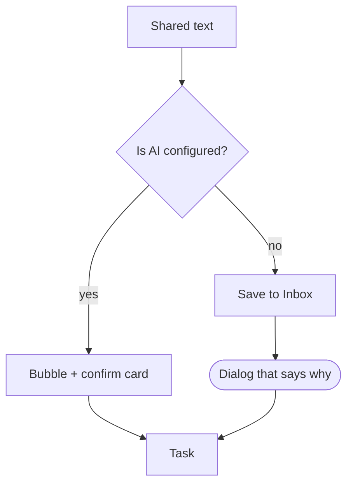
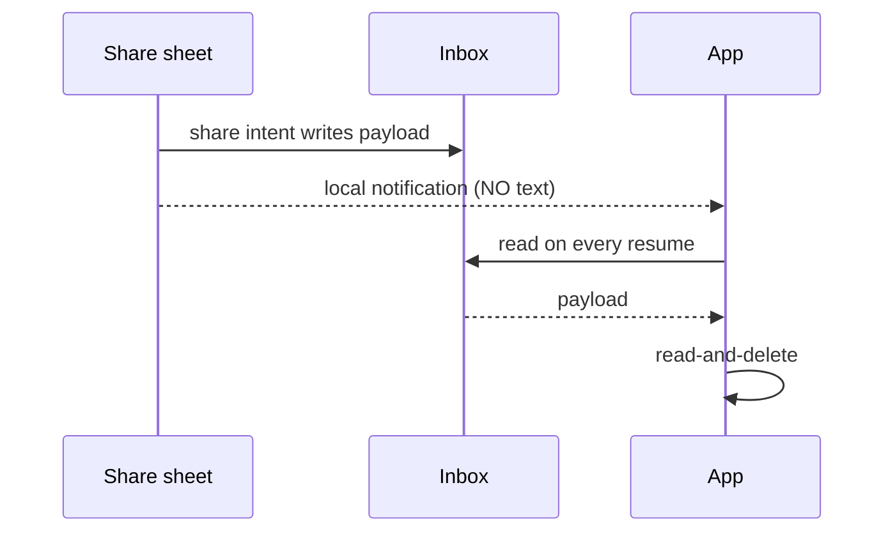
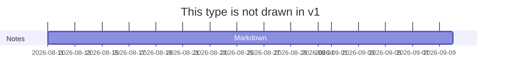

# Markdown conformance fixture

This document exists for **one purpose**: to be the measurable form of the
rule *"if GitHub renders it, RemFT renders it"*.

It does two jobs at once:

1. **The referee for the render engine.** The engine is scored against
   this document: how many sections drew correctly, how many took their theme
   from `RemftTokens`.
2. **The regression net.** Every section gets a **structural**
   assert (not a golden — which view was drawn).

> [!IMPORTANT]
> To exercise the security surface, this file **deliberately** carries inputs
> that look harmful: a `javascript:` link, an HTML block that must not go live
> and an image that cannot be resolved. They are **test cases**, not attacks —
> the proof of the "a document is untrusted input" rule comes from here.

Sections have fixed headings; tests target them by their anchors.

---

## Inline formatting

Plain text, **bold**, *italic*, ***bold italic***, ~~strikethrough~~,
`inline code`, ==highlighted text== and an escape: \*not an asterisk\*.

Emoji shortcode: :rocket: :warning: :white_check_mark:

Autolink (no markup, a bare URL): https://example.com

Explicit link: [RemFT](https://example.com "title text")

A line broken by two trailing spaces  
and its continuation.

Footnote call: markdown is a document format[^1] and GFM is its dialect[^gfm].

---

## Headings and anchors

### Third level

#### Fourth level

##### Fifth level

###### Sixth level

---

## Café résumé

This section exercises where **heading anchors and search folding** meet, and its heading is
non-ASCII on purpose. GitHub's slug rule says "lowercase, turn spaces into
dashes, drop punctuation" — but **SQLite does not fold** `İ`/`ı`
correctly (DUCET weighs them separately), so anchor generation has to be
app-owned, through the app's own fold.

**All three** links below must reach their target:

- [Go to the non-ASCII heading](#café-résumé)
- [Back to inline formatting](#inline-formatting)
- [Go to tables](#tables)

---

## Lists

### Unordered, three levels deep

- First level
  - Second level
    - Third level
    - Third level, second item
  - Back to the second level
- Back to the first level

### Ordered and renumbered

1. First
2. Second
   1. Nested first
   2. Nested second
3. Third

### Misnumbered in the source (should render 1-2-3)

1. One
1. Two
1. Three

### Task list (tappable in reading mode, writes to the document)

- [ ] Item not done
- [x] Item done
- [ ] Nested task list
  - [x] Sub-item done
  - [ ] Sub-item open

### Loose, definition-like list

- **Term** — explained on the same line.

- **Second term** — there is a blank line in between, so this list is
  *loose* and its items are wrapped as paragraphs.

---

## Tables

### Aligned

| Left      | Centred   | Right |
| :-------- | :-------: | ----: |
| `md`      | text      |     1 |
| `json`    | JSON      |    42 |
| **bold**  | ~~struck~~ |  100 |

### Wide — the proof of sideways scrolling (scrolls sideways in its own box, the page must not move)

| Field | Type | Nullable | Default | Description | Table | Version | Note |
| ----- | ---- | -------- | ------- | ----------- | ----- | ------- | ---- |
| `id` | `text` | no | — | ULID primary key | `notes` | v1 | Crockford |
| `title` | `text` | no | — | note title | `notes` | v1 | folded into `title_fold` |
| `content_markdown` | `text` | yes | `null` | markdown body | `notes` | v1 | canonical |
| `plain_text` | `text` | yes | `null` | body without markup | `notes` | v1 | folded into `body_fold` |
| `is_archived` | `boolean` | no | `false` | hidden from lists | `notes` | v1 | kept on export |

---

## Quotes and alert boxes

> A plain quote.
>
> > A nested quote.

> [!NOTE]
> Information the reader will find useful.

> [!TIP]
> A suggestion that makes things easier.

> [!IMPORTANT]
> Information critical to reaching the goal.

> [!WARNING]
> Content that needs attention and may be urgent.

> [!CAUTION]
> The possible negative consequences of an action.

---

## Code blocks

With a language label — the label **and** the copy button must show:

```dart
/// This block of the fixture exercises syntax highlighting.
String slugify(String heading) =>
    foldSearchText(heading).replaceAll(RegExp(r'[^a-z0-9]+'), '-');
```

```js
// A JavaScript sample for the highlighter.
export async function load(store) {
  const notes = await store.all('notes');
  return notes.filter((n) => !n.archived).map((n) => n.title);
}
```

A fence without a language:

```
a plain-text fence — no highlighting, but the box and the copy button must still be there
```

A block with a very long line (it scrolls inside its own box):

```sql
SELECT n.id, n.title, n.content_markdown, n.is_pinned, n.updated_at FROM notes n WHERE n.is_archived = 0 AND n.workspace_id = ? ORDER BY n.is_pinned DESC, n.updated_at DESC LIMIT 50;
```

A code block written by indentation:

    this is a code block too (four spaces)

---

## Math

Inline: $E = mc^2$ and $\sum_{i=1}^{n} i = \frac{n(n+1)}{2}$.

Block:

$$
\int_{0}^{\infty} e^{-x^2}\,dx = \frac{\sqrt{\pi}}{2}
$$

$$
\begin{aligned}
f(x) &= (x+1)^2 \\
     &= x^2 + 2x + 1
\end{aligned}
$$

---

## Diagrams

### Flowchart



### Sequence



### Unsupported type — must fall back to an honest placeholder



### Broken mermaid — a placeholder again, but the reason must be "could not be parsed"

```mermaid
flowchart TD
    A[Unclosed square bracket --> B
    B -->
```

---

## Images

An image with a relative path, resolved against this fixture's own folder.
Resolving a
relative path only means something on the external-file path: a note's
embeds are `remft://file/{id}`, while the images of a `.md` opened from disk
are relative to its own folder. An engine that cannot resolve it must be able
to **tell it apart from a broken image**.


A broken image — not a gap, an honest placeholder:


An image wrapped in a link:

[](https://example.com)

---

## Security cases

**None** of these may go live.

A link with the `javascript:` scheme — must be inert text, not tappable:

[Click me](javascript:alert('xss'))

A link with the `data:` scheme — same rule:

[Data URI](data:text/html;base64,PHNjcmlwdD5hbGVydCgxKTwvc2NyaXB0Pg==)

An HTML block — must be drawn as escaped **source**, never as a live DOM:

<div style="background:red">
  <script>alert('this must never run')</script>
  
  <a href="javascript:void(0)">nor this one</a>
</div>

Inline HTML:

In this sentence <b>should not be bold</b> and <script>alert(1)</script> must be visible source.

A remote image — must follow the rules for note embeds:


---

## Horizontal rules and the end

Three different spellings, all three must draw the same thing:

---

***

___

## Footnotes

[^1]: The footnote body. A tap jumps down to it, and you can jump back.
[^gfm]: GitHub Flavored Markdown — covers tables, task lists, footnotes,
    strikethrough, autolinks, alert boxes, mermaid fences and `$…$` math.
